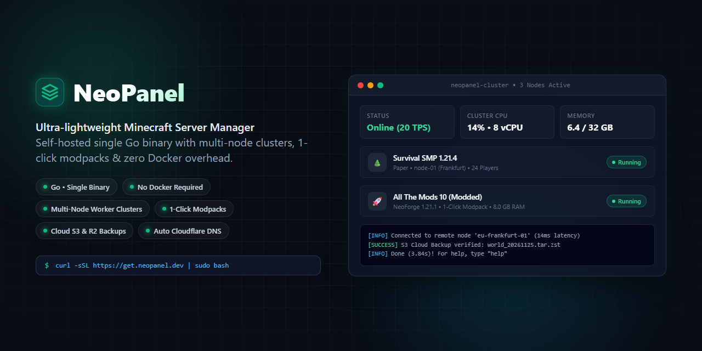

# NeoPanel

<p align="center">
  
</p>

[](https://github.com/Pekly/NeoPanel)

NeoPanel is a web panel for running Minecraft servers. Start a server, watch its console, edit files, install plugins or mods, and manage backups from your browser. You can keep everything on one machine or connect workers on other hosts.

The backend is written in Go, with the web interface and a SQLite database built in. You don't need PHP, a separate database server, or Docker to run the panel.

## What you can do

- Run Paper, Purpur, Fabric, Forge, NeoForge, Vanilla, proxies such as Velocity, and [Steel](https://steelmc.dev/).
- Install complete Modrinth modpacks in 1-click with automatic client-mod filtering and loader alignment.
- Manage Java versions, server settings, files, plugins, and mods without leaving the panel.
- Store backups locally or push offsite to S3-compatible cloud storage (Cloudflare R2, AWS, Backblaze B2).
- Automate custom domain routing with direct Cloudflare DNS & SRV record synchronization.
- Create backups and schedules, or warn players before a planned restart with a countdown you can cancel.
- Give friends or teammates access to individual servers, with control over what each person can do.
- Pin your usual servers, filter console output, and pick up where you left off after refreshing the page.

During panel maintenance, users can still access their servers' power controls and console. Their normal permissions still apply.

## Install on Linux

The installer is tested on Ubuntu 24.04 LTS. On your server, run:

```bash
curl -sSL https://raw.githubusercontent.com/Pekly/NeoPanel/main/install.sh | sudo bash
```

It builds NeoPanel, installs the required Go and Java tools, sets up the service and firewall rules, and can configure HTTPS with Caddy. You can [read the script](install.sh) first to see what it changes.

For an unattended install:

```bash
curl -sSL https://raw.githubusercontent.com/Pekly/NeoPanel/main/install.sh | sudo bash -s -- \
  --install --domain panel.example.com --email you@example.com -y
```

Open the address shown at the end of the install and create your admin account. The getting-started guide will help you create your first server. Choose **Local** if you want to run it on the same machine as the panel; you don't need to set up a separate worker.

Players join using the **Minecraft host and port** shown on the server card, not the panel's web address. Click the address to copy it.

### Add another host

Create an administrator API key under **Account → API Keys**, then run this on the Linux worker machine:

```bash
curl -sSL https://raw.githubusercontent.com/Pekly/NeoPanel/main/install.sh | sudo bash -s -- \
  --node --master https://panel.example.com \
  --api-key neo_your_admin_api_key_here --name eu-node-01 --location "Frankfurt, DE"
```

Workers run the game servers; you manage them from the same panel. Use HTTPS or a trusted private/VPN network between the panel and its workers, and keep your API keys private.

### Hosting on Windows

You can also connect a [Windows worker](docs/windows.md#optional-api-only-windows-worker) to host Minecraft servers on a Windows PC. The guide covers building it, connecting it to the panel, and where it stores your servers. It doesn't require the desktop app.

Windows hosting is for trusted servers: its process and memory controls don't isolate files or network access. For untrusted workloads, use a Linux host with the supported isolation configured.

## Updates and troubleshooting

```bash
sudo neopanel-update
sudo neopanel-installer          # reopen the installer menu
systemctl status neopanel
journalctl -u neopanel -f
```

Back up your worlds, configuration, and database before updating. Update the panel and workers together so their APIs stay compatible. If you're upgrading an older installation, check the [security upgrade notes](docs/security-upgrade.md).

On Linux, configuration is in `/etc/neopanel/config.yaml`, server data is under `/var/lib/neopanel`, and installer logs are in `/var/lib/neopanel/installer/install.log`.

## Granular permissions and team access

Global accounts have two roles: **Admin** (panel settings, node configuration, and creating servers) and **User** (accessing owned or shared servers).

Access to individual servers is completely granular. Server owners and admins can invite teammates from the **Team** tab and assign any combination of **13 granular permissions**:

- **Console**: `console.view` (live terminal monitoring), `console.command` (send stdin commands)
- **Power**: `server.power` (start, stop, restart, kill)
- **File Manager**: `files.view` (browse files), `files.edit` (create, edit, unzip, upload), `files.delete` (delete files and purge trash)
- **Backups**: `backup.manage` (create, download, restore, delete local and cloud S3 backups)
- **Databases**: `database.manage` (create, view credentials, reset passwords, delete databases)
- **Schedules**: `schedules.manage` (create, trigger, pause, delete cron tasks)
- **Team**: `subusers.manage` (invite members and manage granular permissions)
- **Configuration**: `settings.view` (inspect properties & network), `settings.edit` (modify flags, JVM runtime, config)
- **SFTP**: `sftp.access` (direct SFTP client connectivity)

## Security architecture and sandbox model

- **Filesystem Isolation**: On Linux, servers run in unprivileged [Bubblewrap](https://github.com/containers/bubblewrap) (`bwrap`) containers. Only the server's working directory is mounted read-write. Host paths (`/usr`, `/bin`, `/lib`) are mounted read-only, sensitive paths (`/etc/shadow`, `/etc/sudoers`) are masked with `/dev/null`, and all Linux capabilities are dropped (`--cap-drop ALL`).
- **Resource Ceilings**: Bubblewrap runs within systemd scopes (`systemd-run --scope`) to enforce strict cgroup v2 CPU quotas (`CPUQuota`), process count ceilings (`TasksMax`), and hard memory limits (`MemoryMax` with zero swap allowance).
- **Network Architecture**: The sandbox uses `--share-net` so Minecraft servers can listen on their allocated ports and authenticate player sessions with Mojang API servers (`sessionserver.mojang.com`) without container NAT overhead. To prevent untrusted plugins from scanning host loopback services, administrators can isolate internal services (e.g., binding databases to Unix sockets) or configure local firewall egress filters.
- **Disk Limits**: Server disk quotas (`DiskLimitMB`) are strictly checked across all operations: pre-flight checks before server startup, File Manager uploads, SFTP transfers, backup creations, restores, world conversions, and plugin updates. A background watchdog inspects running servers every 20 seconds; servers exceeding quota receive in-game warnings and trigger `save-all`, and runaway servers exceeding 115% of quota are halted to prevent host storage exhaustion.
- **Service Sandboxing**: The systemd service (`neopanel.service`) includes strict sandboxing directives (`ProtectSystem=strict`, `ProtectHome=true`, `PrivateTmp=true`, `ProtectKernelTunables=true`) restricting panel writes exclusively to `/var/lib/neopanel`, `/etc/neopanel`, and runtime paths.

A few things worth setting up before inviting people:

- Configure SMTP and the public panel URL if you want invitation and password-reset emails to work.
- Give each person their own account and only the permissions they need.
- Stop a server before taking a consistent world backup. Restoring a backup replaces its current files.
- Don't run two panel instances against the same database or server folders.
- For untrusted Linux workloads, use Bubblewrap isolation. Resource limits alone aren't a filesystem sandbox.

More help: [invitations](docs/invitation-account-lifecycle.md), [Cloudflare DNS](docs/cloudflare-dns.md), [1-Click Modpacks](docs/modpacks.md), [Cloud Backups](docs/cloud-backups.md), [file previews](docs/file-previews.md), [Trash](internal/trash/README.md), [server deletion](docs/server-deletion.md), and [workspace and console controls](docs/panel-qol.md).

## Working on NeoPanel

You'll need Go 1.26 or newer. The frontend is plain JavaScript and CSS, so there's no bundler or npm install step. Node.js is used for the frontend tests.

```bash
git clone https://github.com/Pekly/NeoPanel.git
cd NeoPanel
make build                       # writes bin/neopanel
go test ./...
go vet ./...
node --test web/tests/*.test.cjs
```

On Linux, you can also run the installer checks:

```bash
bash tests/install-isolation.test.sh
bash tests/install-build.test.sh
```

Found a bug? [Open an issue](https://github.com/Pekly/NeoPanel/issues) with what you were doing, what happened, your OS and version, and any useful logs. Please remove passwords and tokens before posting.

## License

[MIT](https://opensource.org/license/mit).
